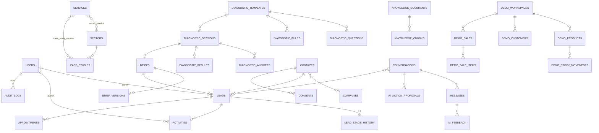

# BACKEND SCHEMA — Kilakodon Hub

> Base MySQL / MariaDB, InnoDB, `utf8mb4_unicode_ci`. **Toutes les tables sont préfixées `kh_`** via `DB_PREFIX`. Les noms ci-dessous sont sans préfixe, comme dans les migrations Laravel.
> Conventions : `id` = `bigIncrements` sauf mention contraire ; `timestamps()` partout ; `softDeletes()` uniquement où indiqué. Les colonnes `json` sont castées en `array` / `AsCollection`. Les montants sont des entiers en FCFA (`*_xof`). Les tokens sont stockés hachés (SHA-256, `char(64)`).
> Toutes les valeurs d'enum sont stockées en `string(32)` (et non en ENUM SQL) et validées par un enum PHP natif dans `app/Domain/*/Enums`.

---

## 1. Vue d'ensemble (ERD logique)

---

## 2. Plateforme

### users
| Colonne | Type | Contraintes / notes |
|---|---|---|
| name | string(120) | |
| email | string(190) | unique |
| password | string | |
| role | string(32) | `admin` \| `sales` \| `editor` |
| is_active | boolean | défaut true |
| last_login_at | timestamp null | |
| app_authentication_secret, app_authentication_recovery_codes | text null | MFA Filament (noms selon la version de Filament) |
| remember_token | | |

### settings
Clé/valeur typée, mise en cache 10 min, invalidée à la sauvegarde.
| Colonne | Type | Notes |
|---|---|---|
| key | string(100) | unique — ex. `contact.whatsapp_primary`, `contact.hours`, `notify.lead_recipients`, `ai.enabled`, `ai.daily_budget_usd`, `ai.max_messages_per_conversation`, `consent.texts` |
| value | json | |
| updated_by | foreignId users null | |

### audit_logs
| Colonne | Type | Notes |
|---|---|---|
| user_id | foreignId users null | null = système |
| action | string(64) | `login`, `role_changed`, `published`, `contact_merged`, `exported`, `anonymized`, `setting_changed`, … |
| auditable_type / auditable_id | morphs null | |
| changes | json null | avant/après, sans secrets |
| ip_hash | char(64) null | |
| created_at | timestamp | index |
Pas d'`updated_at`. Écriture seule (aucune modification depuis l'admin).

### sequences
| Colonne | Type | Notes |
|---|---|---|
| name | string(32) | ex. `brief` |
| year | smallInteger | |
| last_value | unsignedInteger | |
Unique (`name`, `year`). Incrément sous `lockForUpdate()` dans une transaction → `KLK-{year}-{str_pad(n,4,'0')}`.

### outbound_messages
| Colonne | Type | Notes |
|---|---|---|
| channel | string(16) | `email` (MVP) |
| to | string(190) | |
| template | string(64) | `lead_new_internal`, `lead_ack`, `appointment_confirmed`, `lead_unattended`, `ai_budget_alert` |
| payload | json | variables du modèle |
| status | string(16) | `queued` \| `sent` \| `failed` \| `abandoned` |
| attempts | unsignedTinyInteger | |
| last_error | text null | |
| related_type / related_id | nullableMorphs | |
| sent_at | timestamp null | |

### analytics_events
| Colonne | Type | Notes |
|---|---|---|
| name | string(48) | index |
| visitor_key | uuid null | index |
| path | string(255) null | |
| properties | json null | liste blanche (TRD §9) |
| utm | json null | |
| occurred_at | timestamp | index |
Pas de `timestamps()`. Index composite (`name`, `occurred_at`).

### Tables Laravel standard
`jobs`, `job_batches`, `failed_jobs`, `cache`, `cache_locks`, `sessions`, `password_reset_tokens`.

---

## 3. Contenus

Colonnes communes aux contenus publiables (trait `Publishable`) : `slug` string(140) unique, `status` string(16) (`draft` \| `review` \| `published` \| `archived`), `published_at` timestamp null, `seo_title` string(70) null, `seo_description` string(170) null, `og_image_path` string null, `sort` unsignedSmallInteger défaut 0, `created_by` / `updated_by` foreignId users null. **softDeletes**.

### services (solutions)
| Colonne | Type | Notes |
|---|---|---|
| module_code | string(48) null | lien vers le catalogue de modules du diagnostic (`MOD_*`) |
| title | string(120) | |
| tagline | string(200) | |
| icon | string(48) | nom d'icône (jeu Lucide) |
| problem | text | Markdown |
| audience | text | Markdown |
| benefits | json | `[{title, text}]` |
| features | json | `[{title, text}]` |
| process | json null | étapes spécifiques |
| limits | text null | « Ce que ce n'est pas » |
| duration_hint | string(120) null | ex. « 6 à 10 semaines [À VALIDER] » |
| price_hint | string(120) null | null = « Sur devis après diagnostic » |
| faq | json null | `[{q, a}]` |

### sectors
| Colonne | Type | Notes |
|---|---|---|
| code | string(48) | valeur du diagnostic (`retail`, `school`, …) — unique |
| name | string(120) | |
| headline | string(200) | |
| intro | text | |
| pain_points | json | `[{title, text}]` |
| outcomes | json | `[{title, text}]` |
| demo_slug | string null | démo associée |
Pivot `sector_service` (`sector_id`, `service_id`, `sort`).

### case_studies
| Colonne | Type | Notes |
|---|---|---|
| title | string(160) | |
| client_display | string(16) | `named` \| `anonymized` |
| client_name | string(160) null | requis si `named` |
| client_descriptor | string(160) | ex. « Chaîne de 3 boutiques, Bamako » |
| sector_id | foreignId null | |
| context, challenge, intervention | text | Markdown |
| deliverables | json | |
| results | text null | |
| results_verified | boolean | défaut false ; si false → résultats non affichés |
| quote, quote_author | text / string null | affichés seulement si autorisation `granted` |
| authorization_status | string(16) | `none` \| `pending` \| `granted` \| `refused` |
| authorization_note | text null | preuve : date, canal, interlocuteur |
| authorized_by | foreignId users null | admin qui atteste |
| authorized_at | timestamp null | |
| cover_path | string null | |
Pivot `case_study_service`. **Règle** (Observer et Policy) : `status → published` impossible si `authorization_status ≠ granted`.

### articles
`title`, `excerpt` string(300), `body` longText (Markdown), `category` string(48), `author_id` foreignId users, `reading_minutes` tinyInteger, `cover_path`.

### faqs
`question` string(255), `answer` text, `category` string(48) (`general`, `pricing`, `process`, `support`, `diagnostic`, `ai`), `sort`, `status`.

### pages
`slug`, `title`, `body` longText (Markdown), `template` string(32) (`default`, `legal`), `status`. Utilisées pour : `methode`, `a-propos`, `mentions-legales`, `confidentialite`, `cookies`.

### content_revisions
| Colonne | Type | Notes |
|---|---|---|
| revisionable_type / revisionable_id | morphs | |
| version | unsignedInteger | |
| data | json | snapshot complet des attributs éditables |
| user_id | foreignId null | |
| created_at | timestamp | |
Créées par le trait `HasRevisions` à chaque sauvegarde ; action « Restaurer » dans Filament.

---

## 4. Diagnostic

### diagnostic_templates
| Colonne | Type | Notes |
|---|---|---|
| name | string(120) | |
| version | unsignedInteger | unique |
| status | string(16) | `draft` \| `active` \| `retired` — **un seul `active`** (vérifié par l'Action d'activation) |
| activated_at | timestamp null | |
| notes | text null | |
Un template `active` ou `retired` est **immuable** (Policy et Observer).

### diagnostic_questions
| Colonne | Type | Notes |
|---|---|---|
| template_id | foreignId cascade | |
| key | string(48) | unique (`template_id`, `key`) |
| step | unsignedTinyInteger | 1–4 |
| label | string(255) | |
| help | string(255) null | |
| type | string(16) | `single` \| `multi` \| `text` \| `number` |
| options | json null | `[{value, label, hint?, show_if?, exclusive?}]` — `show_if` filtre l'option, `exclusive` (ex. `none`) désélectionne les autres |
| allow_unknown | boolean | ajoute « Je ne sais pas » (`__unknown`) |
| required | boolean | |
| max_selections | tinyInteger null | pour `multi` |
| show_if | json null | condition (TRD §6) |
| sort | unsignedSmallInteger | |

### diagnostic_rules
| Colonne | Type | Notes |
|---|---|---|
| template_id | foreignId cascade | |
| key | string(48) | unique (`template_id`, `key`) |
| name | string(160) | |
| conditions | json | |
| effects | json | `[{type:"recommend", module, weight} \| {type:"pain", key} \| {type:"clarify", key}]` |
| explanation | string(255) | phrase « Pourquoi » affichée au prospect |
| priority | unsignedSmallInteger | |
| is_active | boolean | |

### diagnostic_sessions
| Colonne | Type | Notes |
|---|---|---|
| id | ulid primary | |
| template_id | foreignId | |
| resume_token_hash | char(64) | unique |
| status | string(16) | `in_progress` \| `completed` \| `saved` \| `converted` \| `expired` |
| current_step | unsignedTinyInteger | |
| entry | string(64) null | `home`, `sector:school`, `lab`, … |
| prefill | json null | |
| visitor_key | uuid null | |
| ip_hash | char(64) | |
| utm | json null | |
| started_at, completed_at, expires_at | timestamps | `expires_at` index |

### diagnostic_answers
| Colonne | Type | Notes |
|---|---|---|
| session_id | ulid FK cascade | |
| question_key | string(48) | unique (`session_id`, `question_key`) |
| value | json | chaîne, tableau, nombre ou `"__unknown"` |

### diagnostic_results
| Colonne | Type | Notes |
|---|---|---|
| session_id | ulid FK unique | |
| template_version | unsignedInteger | |
| maturity_score | decimal(4,1) | |
| maturity_level | unsignedTinyInteger | 1–4 |
| pains | json | `[{key, label, rule_keys[]}]` |
| recommendations | json | `[{module, weight, label, reasons:[{rule_key, explanation, question_keys[]}]}]` |
| clarifications | json | `[{key, label}]` |
| ai_summary | text null | |
| ai_summary_model | string(64) null | |
| computed_at | timestamp | |

---

## 5. Brief et CRM

### contacts
| Colonne | Type | Notes |
|---|---|---|
| company_id | foreignId null | |
| full_name | string(160) | |
| phone_e164 | string(20) null | index |
| whatsapp_e164 | string(20) null | index |
| email | string(190) null | index |
| job_title | string(120) null | |
| city | string(80) null | |
| country_code | char(2) | défaut `ML` |
| preferred_channel | string(16) | `whatsapp` \| `phone` \| `email` |
| marketing_opt_in | boolean | défaut false (miroir du dernier consentement marketing) |
| anonymized_at | timestamp null | |
| merged_into_id | foreignId contacts null | |
softDeletes. Au moins un parmi `phone_e164`, `whatsapp_e164` ou `email` (validation).

### companies
`name` string(160), `sector_code` string(48) null, `size_band` string(16) null (`1_5`, `6_20`, `21_50`, `51_200`, `200_plus`), `sites_band` string(16) null, `city` string(80) null. softDeletes.

### briefs
| Colonne | Type | Notes |
|---|---|---|
| reference | string(16) | unique — `KLK-2026-0042` |
| diagnostic_session_id | ulid null unique | |
| conversation_id | ulid null | origine assistant |
| contact_id | foreignId null | renseigné à la soumission des coordonnées |
| status | string(16) | `draft` \| `validated` |
| current_version | unsignedInteger | |
| access_token_hash | char(64) | unique |
| access_expires_at | timestamp | |
| access_revoked_at | timestamp null | |
| validated_at | timestamp null | |
| pdf_path | string null | stockage privé (`storage/app/private/briefs`) |

### brief_versions
| Colonne | Type | Notes |
|---|---|---|
| brief_id | foreignId cascade | |
| version | unsignedInteger | unique (`brief_id`, `version`) |
| declared | json | réponses et informations saisies par le prospect |
| recommended | json | copie figée des recommandations et priorités (règles) |
| summary | text | résumé (IA ou gabarit), éventuellement corrigé par le prospect |
| summary_source | string(16) | `ai` \| `template` \| `prospect_edited` |
| prospect_comment | text null | |
| created_by | string(16) | `prospect` \| `staff` \| `assistant` |
| created_at | timestamp | |
Immuable après création.

### leads
| Colonne | Type | Notes |
|---|---|---|
| contact_id | foreignId | |
| company_id | foreignId null | |
| brief_id | foreignId null unique | |
| type | string(16) | `diagnostic` \| `contact` \| `appointment` \| `assistant` \| `lab` |
| source | string(64) | `organic`, `whatsapp`, `lab:retail`, `assistant`, … |
| message | text null | |
| stage | string(16) | `new` \| `qualified` \| `meeting` \| `proposal` \| `won` \| `lost` \| `on_hold` — index |
| owner_id | foreignId users null | index |
| next_action | string(255) null | |
| next_action_at | timestamp null | index |
| fit_score | unsignedTinyInteger null | 1–3 |
| maturity_level | unsignedTinyInteger null | copie du diagnostic |
| budget_band | string(16) null | déclaré |
| timeline | string(16) null | déclaré |
| decision_role | string(16) null | `decider` \| `influencer` \| `researcher` |
| estimated_amount_xof | unsignedBigInteger null | saisi par le commercial |
| lost_reason | string(64) null | `price`, `timing`, `competitor`, `no_response`, `not_a_fit`, `other` |
| first_response_at | timestamp null | calcul du délai de prise en charge |
| idempotency_key | char(64) | unique |
| utm | json null | |
softDeletes.

### lead_stage_history
`lead_id`, `from_stage` null, `to_stage`, `user_id` null, `reason` string(255) null, `created_at`.

### activities
| Colonne | Type | Notes |
|---|---|---|
| lead_id | foreignId cascade | |
| user_id | foreignId null | |
| type | string(16) | `note` \| `call` \| `whatsapp` \| `email` \| `meeting` \| `task` \| `system` |
| body | text | |
| due_at | timestamp null | tâches |
| done_at | timestamp null | |
Toujours internes : jamais exposées publiquement.

### appointments
| Colonne | Type | Notes |
|---|---|---|
| lead_id | foreignId | |
| status | string(16) | `requested` \| `confirmed` \| `cancelled` \| `done` \| `no_show` |
| channel | string(16) | `whatsapp` \| `phone` \| `video` \| `onsite` |
| topic | string(255) | |
| preferred_slots | json | `[{date, period: morning\|afternoon\|evening}]` (1 à 3) |
| scheduled_at | timestamp null | requis si `confirmed` |
| timezone | string(48) | défaut `Africa/Bamako` |
| confirmed_by | foreignId users null | |
| notes | text null | |

### consents
| Colonne | Type | Notes |
|---|---|---|
| contact_id | foreignId null | |
| visitor_key | uuid null | |
| purpose | string(32) | `request_processing` \| `marketing` \| `analytics` |
| granted | boolean | |
| text_version | string(16) | version du texte affiché (settings `consent.texts`) |
| source | string(32) | `brief_form`, `contact_form`, `appointment_form`, `assistant`, `cookie_banner` |
| ip_hash | char(64) null | |
| created_at | timestamp | |
| withdrawn_at | timestamp null | |
Écriture seule. Un retrait crée une nouvelle ligne `granted = false`.

### privacy_requests
`contact_id` null, `requester_name`, `requester_channel` (texte), `type` (`access` \| `rectification` \| `erasure` \| `objection`), `status` (`received` \| `verifying` \| `in_progress` \| `done` \| `rejected`), `verified_at`, `handled_by`, `decision_note` text, `completed_at`.

---

## 6. Assistant IA

### knowledge_documents
| Colonne | Type | Notes |
|---|---|---|
| title | string(200) | |
| source_type | string(16) | `service` \| `sector` \| `faq` \| `page` \| `article` \| `case_study` \| `manual` |
| source_id | unsignedBigInteger null | unique (`source_type`, `source_id`) quand non null |
| body | longText null | pour `manual` uniquement (Markdown) |
| url | string(255) | lien public cité |
| status | string(16) | `draft` \| `approved` \| `retired` |
| version | unsignedInteger | |
| approved_by | foreignId users null | |
| approved_at | timestamp null | |
| review_at | date null | |
| expires_at | timestamp null | |

### knowledge_chunks
| Colonne | Type | Notes |
|---|---|---|
| document_id | foreignId cascade | |
| document_version | unsignedInteger | |
| position | unsignedSmallInteger | |
| heading | string(255) | |
| content | text | |
| url | string(255) | avec ancre si possible |
| words | unsignedSmallInteger | |
**`FULLTEXT ft_chunks (heading, content)`** — créé via `$table->fullText(['heading','content'])`.

### conversations
| Colonne | Type | Notes |
|---|---|---|
| id | ulid primary | |
| visitor_key | uuid null | |
| ip_hash | char(64) | |
| lead_id | foreignId null | lien après conversion |
| status | string(16) | `open` \| `handed_off` \| `closed` |
| entry_path | string(255) null | |
| message_count | unsignedSmallInteger | |
| tokens_in, tokens_out | unsignedInteger | |
| cost_estimate_usd_micros | unsignedBigInteger | coût estimé en millionièmes de dollar |
| last_message_at | timestamp | |

### messages
| Colonne | Type | Notes |
|---|---|---|
| conversation_id | ulid FK cascade | |
| role | string(16) | `user` \| `assistant` \| `notice` |
| content | text | |
| citations | json null | `[{chunk_id, url, title}]` (validées côté serveur) |
| grounding | string(16) null | `sourced` \| `partial` \| `no_source` |
| suggested_action | string(32) null | |
| model | string(64) null | |
| tokens_in, tokens_out | unsignedInteger null | |
| latency_ms | unsignedInteger null | |
| error_code | string(48) null | |
| created_at | timestamp | |

### ai_action_proposals
| Colonne | Type | Notes |
|---|---|---|
| id | ulid primary | |
| conversation_id | ulid FK | |
| type | string(32) | `propose_brief` \| `request_appointment` |
| payload | json | arguments exacts affichés au visiteur |
| payload_hash | char(64) | |
| idempotency_key | char(64) | unique |
| status | string(16) | `proposed` \| `confirmed` \| `executed` \| `failed` \| `cancelled` \| `expired` |
| result_type / result_id | nullableMorphs | lead, appointment ou brief créé |
| error | string(255) null | |
| expires_at, confirmed_at, executed_at | timestamps null | |

### ai_feedback
`message_id` FK, `rating` (`up` \| `down`), `comment` string(500) null, `review_status` (`to_review` \| `reviewed` \| `actioned`), `reviewed_by` null, `review_note` text null.

### ai_usage_daily
`date` date unique, `requests` unsignedInteger, `tokens_in`, `tokens_out`, `cost_estimate_usd_micros`, `blocked_requests`. Incrémentée atomiquement à chaque appel (`increment`) ; lue par `AssistantGuard`.

---

## 7. Démo Lab (isolé, données fictives)

Toutes les tables `demo_*` ont `workspace_id` (ULID FK cascade) avec un index, et utilisent le trait `BelongsToWorkspace` (global scope obligatoire).

| Table | Colonnes principales |
|---|---|
| demo_workspaces | `id` ulid, `token_hash` char(64) unique, `scenario` (`retail`), `ip_hash`, `actions_count`, `expires_at` index |
| demo_products | `sku`, `name`, `category`, `unit` (`pièce`, `sac 25 kg`, `carton`…), `price_xof`, `cost_xof`, `stock_qty` integer, `alert_threshold` integer |
| demo_customers | `name`, `phone_display` (fictif, format `+223 00 00 00 00`) |
| demo_sales | `number` (`DEMO-0001`), `customer_id` null, `payment_method` (`cash` \| `mobile_money` \| `credit`), `total_xof`, `sold_at` |
| demo_sale_items | `sale_id`, `product_id`, `qty`, `unit_price_xof`, `line_total_xof` |
| demo_stock_movements | `product_id`, `type` (`sale` \| `restock` \| `adjustment`), `qty` (signé), `reason`, `created_at` |

Un trigger SQL n'est **pas** utilisé : le stock est mis à jour dans l'Action `RecordDemoSale` (transaction) qui crée la vente, les lignes et les mouvements, puis décrémente le stock.

---

## 8. Règles d'intégrité transverses

1. Les transitions d'état passent **uniquement** par des Actions (`ChangeLeadStage`, `PublishContent`, `ValidateBrief`, `ConfirmAppointment`, `ActivateDiagnosticTemplate`) qui valident la transition, écrivent l'historique et l'audit.
2. `leads.idempotency_key` = SHA-256 de (`type`, `brief_id` ou téléphone normalisé, message tronqué, date du jour) pour les formulaires ; = `ai_action_proposals.idempotency_key` pour l'assistant.
3. Anonymisation (`AnonymizeContact`) : remplace nom, téléphones et e-mail par des valeurs neutres, vide `brief_versions.declared` des champs identifiants, supprime les messages des conversations liées, révoque les tokens, conserve les agrégats (stage, dates) et écrit `audit_logs`.
4. Toute requête sur `demo_*` sans `workspace_id` est un bug (test d'architecture Pest : les modèles `Demo*` utilisent le trait).

## 9. Seeders

| Seeder | Source |
|---|---|
| `SettingsSeeder` | coordonnées (TRD §14), horaires [À VALIDER], textes de consentement v1, `ai.enabled = true`, `ai.daily_budget_usd = 1` en local (0 = IA bloquée, valeur de production à décider — Q-009) |
| `ContentSeeder` | `docs/CONTENT.md` : solutions, secteurs, FAQ, pages, articles (en `draft` s'ils contiennent `[À VALIDER]`) |
| `DiagnosticTemplateV1Seeder` | `docs/DIAGNOSTIC_SPEC.md` : questions, règles, template v1 `active` |
| `KnowledgeSeeder` | génère les documents depuis les contenus publiés et les FAQ (statut `draft`, à approuver) |
| `DemoLabFixtures` | catalogue fictif (utilisé à chaque création d'espace, pas en seed global) |
| `DevSeeder` (local uniquement) | 1 admin, 1 commercial, 1 éditeur, 15 leads fictifs répartis dans les étapes |
